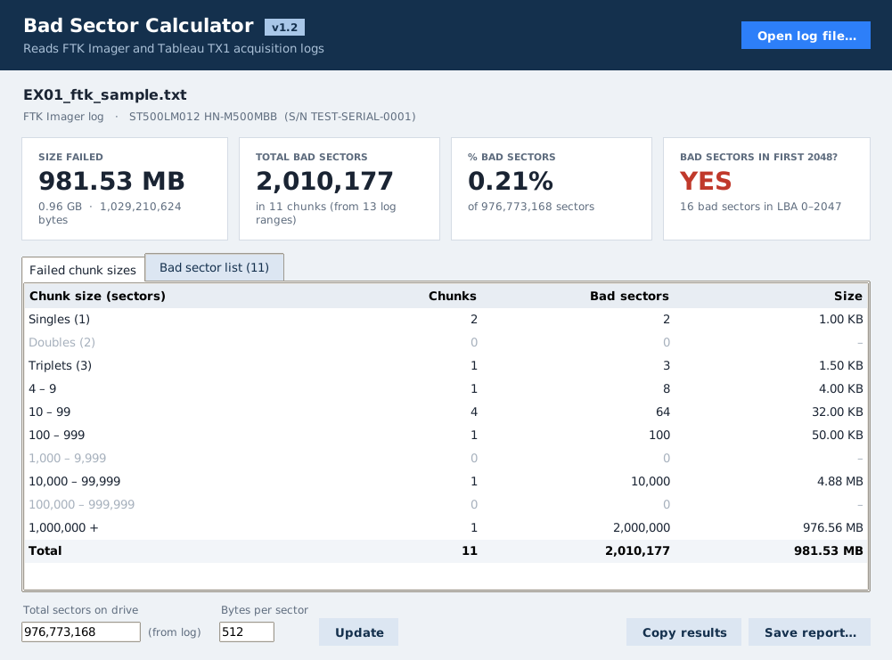
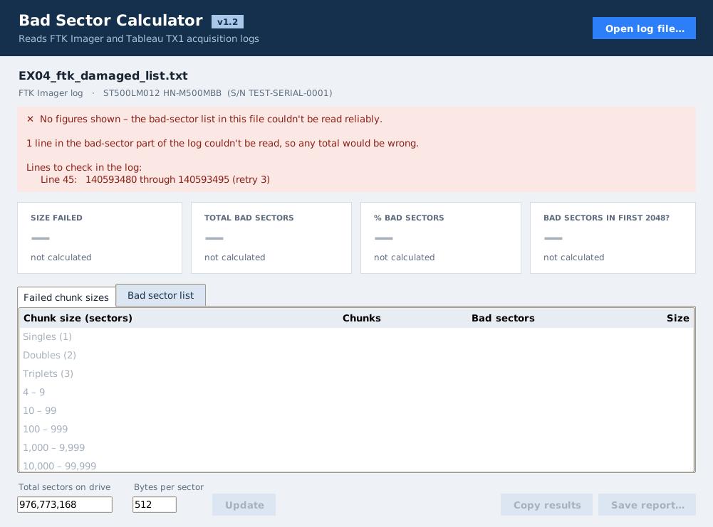

# Bad Sector Calculator

Reads an **FTK Imager** or **Tableau TX1** acquisition log and tells you how much of the drive couldn't be read:

- size failed in MB and GB, total bad sectors and % of the drive
- failed chunk sizes – singles, doubles, triplets, 4–9, 10–99 … 1,000,000+
- whether any bad sectors fall in the first 2048 sectors (LBA 0–2047)

You can copy the results or save a text report. The app only reads the log, never changes it, and works offline.

## Download (Windows)

1. Download the zip from [Releases](../../releases).
2. Unzip it and copy the **Bad Sector Calculator** folder anywhere, e.g. your Desktop.
3. Double-click **Bad Sector Calculator.exe** and open a log. Nothing to install – Python is included.

The `.exe` is only in the release download, because it needs the copy of Python that comes with it. This repository holds the source code.

Each release lists SHA-1 hashes for the zip and for `app/bad_sector_calculator.pyw`. The `.pyw` is the program itself, so its hash identifies the version. The `.exe` is only a launcher and is the same in every version.

## It refuses rather than guesses

Figures are only shown when the whole bad-sector list has been read and hangs together. Otherwise the app shows a red message with the log lines to check and no figures, and Copy and Save are switched off. That happens when:

- a list line isn't exactly sector numbers in the log's format – a stray symbol, a space inside a number, a note after a range
- a line is laid out differently from the rest of the list
- the list goes backwards or overlaps
- FTK's list is missing its closing line, so the log may have been cut off
- the file isn't an FTK Imager or TX1 log, or a TX1 log reports errors without a readable list

A drive is only reported clean when the log confirms it.

In testing, about 64,000 randomly damaged logs gave no wrong figures. Damage that leaves a perfectly normal-looking list – a digit changed to another digit with the list still in order, or a deleted line – can't be detected from the log alone, so hash your logs when the image is made.

## Supported logs

| Log | Status |
|---|---|
| FTK Imager (.txt) | Built from published FTK Imager log excerpts; tested on synthetic logs |
| Tableau TX1 (.txt / .html) | **Unverified** – built from the TX1 manual's description, without a real log containing bad sectors |

**Sample logs wanted.** If the app refuses a log you know is fine, or you have TX1, Guymager, ewfacquire, dc3dd or ddrescue logs with bad sectors, please open an issue with a sanitised copy. Never share case data.

## Running from source

Python 3.8 or newer with Tkinter, standard library only. On Windows use `py` instead of `python3`.

    python3 app/bad_sector_calculator.pyw                     # opens the window
    python3 app/bad_sector_calculator.pyw --report LOGFILE    # prints a text report
    python3 app/bad_sector_calculator.pyw --version

## Tests

    python3 tests/test_calculator.py                                # must end "All checks passed."
    python3 tests/fuzz_logs.py app/bad_sector_calculator.pyw 2000   # random-damage test

On Windows without Python installed, copy `tests` next to `app` in the release folder and run them with `app\runtime\python.exe`.

## What's where

| Folder | Contents |
|---|---|
| `app/` | the program (`bad_sector_calculator.pyw`) and its icons |
| `tests/` | automatic checks and synthetic test logs |
| `launcher/` | source of the Windows `.exe` launcher – see `BUILD.txt` |
| `docs/` | `HOW_TO_EDIT.txt`, a plain-English guide to changing it, and screenshots |

## Before using it in casework

Validate it under your lab's procedures and check some results against the logs by hand.

## Licence

See [LICENSE](LICENSE). The Windows release also bundles Python 3.12 (its licence is in `app/runtime/LICENSE.txt`) and Tcl/Tk.

Created by p0ttah.
